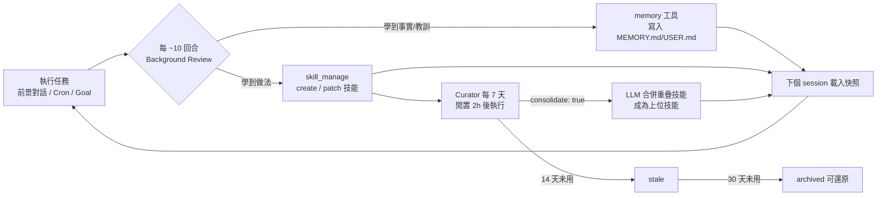

# 01 — Hermes Agent 架構研究筆記

> 研究日期：2026-10-17
> 對象：Nous Research 開源的 **Hermes Agent**（MIT 授權，GitHub `NousResearch/hermes-agent`）
> 目的：弄清楚 Hermes 如何運作，作為「SEO 競爭情報 Agent」的設計基礎。
> 註：標記 ⚠️ 的項目為文件未明確說明、需實機驗證的部分。
>
> **範疇說明（v0.4 起）**：本研究**借用 Hermes 學習迴圈的設計模式**（見 [02 §4](02-seo-intel-agent-design.md)），**不整合其執行環境**。本文件作為背景研究保留；第 9 節的設計約束僅在未來整合 Hermes 執行環境時適用。

---

## 1. Hermes 是什麼

Hermes Agent 是一個「**常駐、會隨使用變強**」的自主 Agent 執行框架。它和一般聊天機器人的差別在於：

| 面向 | 一般 LLM 對話 | Hermes Agent |
|---|---|---|
| 生命週期 | 每次對話從零開始 | 常駐（本機 / VPS / Serverless），有排程、有長期狀態 |
| 記憶 | 無 | 精選記憶（MEMORY.md / USER.md）+ 全部歷史可全文檢索（SQLite FTS5） |
| 能力累積 | 無 | 自動把成功做法寫成 **Skill**（程序性記憶），之後重複使用並修補 |
| 自主性 | 被動回應 | Cron 排程、Persistent Goal 自動續跑、子代理平行作業 |
| 工具 | 視平台 | 60+ 內建工具、MCP、Plugin、7 種終端後端（local/Docker/SSH/Modal…） |

官方宣稱的核心賣點是 **內建學習迴圈（learning loop）**，這正好對應我們需求中的「持續進化」。

---

## 2. 整體架構

```
┌──────────────────────────── 入口 ─────────────────────────────┐
│  CLI (HermesCLI)   Gateway (Telegram/Slack/Discord/Email…)    │
│  Cron Scheduler    Kanban Dispatcher    ACP / Dashboard       │
└───────────────┬───────────────────────────────────────────────┘
                ▼
┌──────────────────────── AIAgent（run_agent.py）─────────────────┐
│ prompt_builder  → 組 system prompt（stable / context / volatile）│
│ conversation_loop → 呼叫模型 → 有 tool_calls 就派送 → 重複      │
│ context_compressor → 超過門檻時摘要中段對話（有損）            │
│ memory_manager / memory_provider → 記憶讀寫                    │
└───────┬──────────────────────┬──────────────────────┬──────────┘
        ▼                      ▼                      ▼
   tools/registry         skills/ (SKILL.md)     hermes_state (SQLite)
   web / terminal /       漸進式載入              state.db：所有 session
   file / browser /       skill_manage 自我修改   FTS5 全文檢索
   delegate / cronjob /
   execute_code / MCP
```

主要原始碼位置（供日後追查）：

- `run_agent.py`（`AIAgent`）、`cli.py`（`HermesCLI`）
- `agent/`：`prompt_builder.py`、`context_compressor.py`、`memory_manager.py`、`prompt_caching.py`
- `tools/`：`registry.py`（匯入時自動註冊）、`delegate_tool.py`、`mcp_tool.py`、`terminal_tool.py`
- `cron/`：`jobs.py`、`scheduler.py`
- `gateway/`：`run.py`（`GatewayRunner`）、`hooks.py`

---

## 3. Agent Loop（一個回合如何執行）

```
使用者輸入 / Cron 觸發 / Goal 續跑
  → build_system_prompt()           # 依 stable → context → volatile 分層
  → resolve_runtime_provider()      # 選模型供應商
  → 呼叫模型（chat_completions / anthropic_messages / codex_responses）
  → 若回應含 tool_calls → handle_function_call() 派送 → 回到上一步
  → 最終回應顯示並寫入 SessionDB
```

設計原則（影響我們的寫法）：

1. **System prompt 在對話中途不變**——為了保住 prompt cache。所以記憶、技能清單只在 session 開始時載入。
2. 工具呼叫可透過 callback / hook 觀察，執行可中斷。
3. 長對話會被 `context_compressor` 摘要（有損），並產生 parent/child session 譜系。

### System Prompt 組成順序

| 層級 | 內容 | 變動頻率 |
|---|---|---|
| stable | 身分（SOUL.md）、工具指引、技能索引 | 幾乎不變 |
| context | 專案脈絡檔（`.hermes.md` > `AGENTS.md` > `CLAUDE.md` > `.cursorrules`，取第一個命中） | 依工作目錄 |
| volatile | 記憶快照、使用者檔案、時間戳 | 每個 session |

---

## 4. 記憶系統（三層）

### 4.1 精選記憶：MEMORY.md / USER.md

位置：`$HERMES_HOME/memories/`

| 檔案 | 用途 | 上限 |
|---|---|---|
| `MEMORY.md` | Agent 自己的筆記：環境事實、慣例、學到的教訓 | **2,200 字元（約 800 tokens）** |
| `USER.md` | 使用者輪廓：偏好、溝通風格 | **1,375 字元（約 500 tokens）** |

- **凍結快照**：session 開始時載入成 system prompt 的一個區塊；中途寫入會立刻存檔，但要到**下一個 session**才看得到。
- `memory` 工具動作只有 `add` / `patch` / `remove`（沒有 `read`、沒有 `replace`）。
- **不會自動壓縮**：寫滿就報錯，Agent 必須自己刪減後再寫。
- 寫入內容會掃描 prompt injection / 外洩樣式。

> ⚠️ **對本專案的意義**：2,200 字元極小，**絕對不能把競品情報存在 Hermes 記憶裡**。情報、假設、證據必須存在我們自己的資料庫；Hermes 記憶只放「指標」與「後設教訓」（例如「資料庫在 `D:\code\seo\data\intel.db`」「驗證假設前先查反例」）。

### 4.2 Session 歷史：state.db + FTS5

- 所有 CLI / 訊息平台的 session 都存在 `$HERMES_HOME/state.db`（SQLite），有 FTS5 全文索引。
- `session_search` 工具回傳原始訊息（不經 LLM 摘要），約 20ms，容量無上限。
- 用途：跨 session 回憶「上次怎麼處理過類似情況」。

### 4.3 外部記憶供應商（選用）

- 內建：RetainDB、ByteRover；Plugin：Honcho、Mem0、Supermemory、Hindsight 等。
- 與內建記憶**並存**，提供知識圖譜、語意搜尋、自動事實萃取。
- 指令：`hermes memory setup`、`hermes memory status`。

---

## 5. 技能系統（程序性記憶）

### 5.1 格式

技能 = 一個資料夾 + `SKILL.md`（相容 agentskills.io 標準）：

```
<skill>/
├── SKILL.md      # 必要：YAML frontmatter + 內文
├── references/   # 補充文件（可放知識庫）
├── templates/    # 輸出格式範本
├── scripts/      # 技能可呼叫的輔助腳本
├── examples/
└── assets/
```

Frontmatter 重點欄位：`name`、`description`、`version`、`platforms`、`required_environment_variables`、`metadata.hermes.{tags, category, requires_tools, requires_toolsets, fallback_for_tools, config}`。

內文建議段落：**When to Use / Procedure / Pitfalls / Verification**。

### 5.2 漸進式揭露（省 token）

| 層級 | 呼叫 | 內容 |
|---|---|---|
| L0 | `skills_list()` | 所有技能的名稱、描述、分類（約 3k tokens） |
| L1 | `skill_view(name)` | 該技能完整內容 |
| L2 | `skill_view(name, path)` | 技能內某個 reference 檔 |

### 5.3 Agent 自我管理技能：`skill_manage`

| 動作 | 用途 |
|---|---|
| `create` | 新增技能 |
| `patch`（old_string → new_string） | 精準修補（官方建議優先） |
| `patch`（content） | 整份改寫 |
| `delete` | 刪除 |
| `write_file` / `remove_file` | 管理 references/scripts 等支援檔 |

Agent 會在這些時機自動建立或改進技能：
- 摸索出多步驟流程後
- 遇到錯誤並找到可行做法後
- 被使用者糾正後

安全閘門：`skills.write_approval: true` 會把所有寫入暫存到 `$HERMES_HOME/pending/skills/`，需人工 `/skills approve <id>` 才生效。

### 5.4 技能來源與優先序

專案技能（`<project>/.hermes/skills/` 或 `.agents/skills/`，需 `hermes skills trust`）→ 本地（`~/.hermes/skills/`）→ `skills.create_dir` → `skills.external_dirs`。

---

## 6. 學習迴圈（「持續進化」的實際機制）



拆解成四個組件：

1. **Nudges（提醒）**：`memory.nudge_interval`、`skills.creation_nudge_interval` 控制多久提醒 Agent 儲存知識。
2. **Background Review（背景回顧）**：大約每 10 回合，fork 一個獨立 AIAgent 回顧剛才的對話，決定要不要寫記憶、建立或修補技能。設定在 `auxiliary.background_review.*`（可指定較便宜的模型）。
3. **Curator（技能園丁）**：
   - 確定性修剪（不花 LLM）：14 天未用 → `stale`，30 天未用 → 封存到 `skills/.archive/`。
   - LLM 整併（預設關閉，`curator.consolidate: true`）：把零碎、近似的技能合併。
   - 被 cron 引用的技能、被 pin 的技能不會被修剪。
   - 全程有備份（`.curator_backups/`）與稽核帳本（`.curator_ledger.jsonl`），可回滾。
4. **Session Search**：跨 session 找回過去的處理經驗。

> ⚠️ **關鍵觀察**：Hermes 的學習迴圈是「**程序性進化**」——它讓 Agent 越來越會「做事」，但**不會**自動判斷「學到的東西是不是對的」。在 SEO 領域，錯誤的因果推論（例如把巧合當成排名因素）一旦被寫成技能，就會被反覆強化。因此我們必須在 Hermes 之上加一層「**假設驗證**」作為品質閘門，只讓通過驗證的知識進入技能。

---

## 7. 自主執行機制

### 7.1 Cron 排程

- 由 Gateway 常駐程序每 60 秒檢查一次到期任務。
- 每次執行都是**全新、無歷史的 session**：prompt 必須自給自足；可附掛技能（`skills=[...]`）。
- 排程格式：`every 2h`、`daily at 7am`、`0 9 * * *`、`in 30m`、ISO 時間戳。
- `workdir="/abs/path"`：在指定目錄執行，並載入該目錄的 `AGENTS.md`。
- **前置腳本 + `wakeAgent` 閘門**：腳本（必須放在 `$HERMES_HOME/scripts/`）最後一行輸出 `{"wakeAgent": false}` 即跳過 LLM，不花 token；也可回傳 `context` 給 Agent。
- **純腳本任務**：`no_agent=True`，完全不呼叫 LLM（適合資料蒐集）。
- **串接**：`context_from` 把上游任務最新輸出接進本任務 prompt；`continuity=true` 帶入自己上次輸出。
- 輸出：`$HERMES_HOME/cron/output/{job_id}/{timestamp}.md`；執行紀錄 `cron/executions.db`。
- 安全：cron session 預設**不能再建立 cron**（防止失控）；`[SILENT]` 開頭不送出、`[CRON_FAILURE]` 開頭標記失敗；連續失敗 3 次會加入檢討提示。

### 7.2 子代理委派：`delegate_task`

- 參數：`goal` + `context`（單一任務）或 `tasks=[...]`（平行批次）；每個任務可帶 `output_schema`（JSON Schema 強制結構化輸出）。
- 預設上限：同時 10 個子代理、深度 1（扁平）、每個子代理 250 次迭代。
- 子代理**不能**：`memory`（寫共享記憶）、`cronjob`、`send_message`、`clarify`。
- 子代理繼承父代理的工具集與 API key；可用 `delegation.model` 指定較便宜的模型。
- 只有最終摘要回到父代理 context → 父代理 context 保持乾淨。

### 7.3 Persistent Goals：`/goal`

- 設定長期目標後，每回合結束由 **judge 模型**判定 `done` / `continue` / `blocked` / `wait`，未完成就自動續跑（預設最多 20 回合）。
- **Completion contract**：`outcome`、`verification`、`constraints`、`boundaries`、`stop_when`——讓 judge 要求具體證據。
- **Quality gates**：shell 指令必須 exit 0 才進入 judge（例如「證據檔通過 schema 驗證」）。

> 這正好可以拿來強制「假設驗證必須附上證據才算完成」。

### 7.4 Kanban 多代理看板

- 跨 profile 共享的持久任務板（`$HERMES_HOME/kanban.db`），任務有依賴關係、狀態（triage → todo → ready → running → review → done）。
- 每個任務指派給一個 **profile**（專職 Agent，各有自己的模型、記憶、技能）。
- 適合「研究員 / 驗證員 / 編輯」分工、需要 review 流程的場景。

### 7.5 程式化工具呼叫：`execute_code`

- Agent 寫 Python 腳本，透過 RPC 呼叫 `web_search`、`web_extract`、`read_file`、`write_file`、`terminal` 等工具；只有 `print()` 的結果回到 LLM → 大量資料處理不污染 context。
- 限制：5 分鐘逾時、每次 50 次工具呼叫、stdout 50KB。
- **環境變數中含 KEY/TOKEN/SECRET 的會被移除**，需透過技能的 `required_environment_variables` 或 `terminal.env_passthrough` 放行。
- Windows 上改用 loopback TCP（非 Unix socket）。⚠️ 需實測穩定性。

---

## 8. 工具與擴充

- **Web**：`web_search`、`web_extract`（不經 LLM 摘要，超長頁面頭 75% + 尾 25% 截斷）、`browser_navigate` / `browser_snapshot`。供應商：Firecrawl（預設）、Exa、Tavily、Brave、SearXNG、DuckDuckGo 等；無金鑰時會輪替免費額度。
- **MCP**：可連任何 MCP server 並過濾工具。SEO 相關：DataForSEO（官方，隨用隨付）、Ahrefs / Semrush（官方遠端，需付費方案）、Google Search Console（僅社群版 `mcp-gsc`）。
- **Hooks**：Plugin hook（`pre_tool_call` 可阻擋/修改工具呼叫、`pre_llm_call` 可注入 context、`post_tool_call` 可記錄）、Gateway hook、Shell hook、Outbound webhook。
- **Profiles**：每個 profile 是獨立的 `HERMES_HOME`（`~/.hermes/profiles/<name>/`），隔離 config、記憶、技能、session、cron。**不要讓兩個執行中的 Agent 共用同一個 profile**。

---

## 9. 對本專案的關鍵啟示（設計約束清單）

| # | Hermes 特性 | 對 SEO 情報 Agent 的設計約束 |
|---|---|---|
| C1 | MEMORY.md 只有 2,200 字元 | 情報資料一律存在專案自己的 SQLite；Hermes 記憶只放指標與後設教訓 |
| C2 | Cron 每次是全新 session | 每個 cron prompt 必須自給自足；靠附掛技能 + `workdir` 載入 `AGENTS.md` 提供脈絡 |
| C3 | Cron 腳本必須在 `$HERMES_HOME/scripts/` | 需要一個部署步驟把專案腳本同步過去（或放薄包裝腳本） |
| C4 | `wakeAgent` 閘門 / `no_agent` | 資料蒐集與變化偵測用純腳本（零 token），有訊號才喚醒 LLM |
| C5 | 子代理不能寫記憶 / 建 cron | 子代理只回傳結構化結果（`output_schema`），由主代理寫入資料庫 |
| C6 | 學習迴圈不檢查知識正確性 | 必須自建「假設 → 驗證 → 晉升」閘門，只有通過驗證的知識才寫進技能 |
| C7 | 記憶為凍結快照 | 同一 session 內的學習要到下次才生效；設計上以「每日/每週一輪」為進化節奏 |
| C8 | `execute_code` 會剝除金鑰環境變數 | 需要 API key 的技能要宣告 `required_environment_variables` |
| C9 | 技能自我修改有風險 | 初期開啟 `skills.write_approval: true`，人工審核 Agent 的自我修改 |
| C10 | Profile 隔離 | 為本專案建立專屬 profile `seo-intel`，避免污染其他用途的記憶與技能 |

---

## 10. 參考來源

- 官方文件首頁：https://hermes-agent.nousresearch.com/docs
- GitHub：https://github.com/NousResearch/hermes-agent
- Architecture：https://hermes-agent.nousresearch.com/docs/developer-guide/architecture
- Memory：https://hermes-agent.nousresearch.com/docs/user-guide/features/memory
- Skills：https://hermes-agent.nousresearch.com/docs/user-guide/features/skills
- Curator：https://hermes-agent.nousresearch.com/docs/user-guide/features/curator
- Cron：https://hermes-agent.nousresearch.com/docs/user-guide/features/cron
- Delegation：https://hermes-agent.nousresearch.com/docs/user-guide/features/delegation
- Goals：https://hermes-agent.nousresearch.com/docs/user-guide/features/goals
- Kanban：https://hermes-agent.nousresearch.com/docs/user-guide/features/kanban
- Web Search：https://hermes-agent.nousresearch.com/docs/user-guide/features/web-search
- Code Execution：https://hermes-agent.nousresearch.com/docs/user-guide/features/code-execution
- Profiles：https://hermes-agent.nousresearch.com/docs/user-guide/profiles
- Hooks：https://hermes-agent.nousresearch.com/docs/user-guide/features/hooks
- SEO MCP 比較（第三方）：https://mcp.directory/blog/best-seo-mcp-servers-2026
