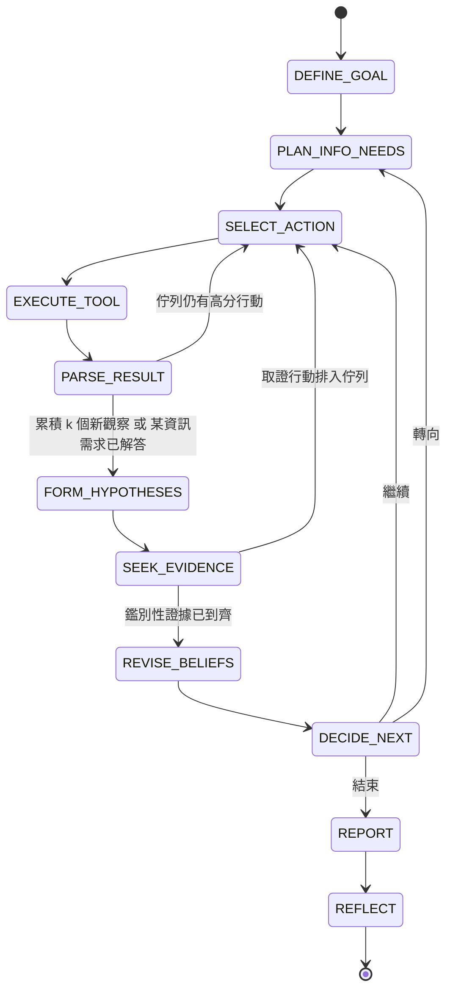

# 04 — 研究迴圈與可觀察性（需求 A）

> 核心原則：迴圈是**程式碼中的狀態機**。LLM 只在指定步驟做「判斷」並以 structured outputs 回傳；「下一步做什麼、能不能做、還剩多少預算」由程式決定。**每一步都要讓使用者看得到。**

---

## 1. 為什麼不是黑盒子

| 黑盒子做法（禁止） | 本設計 |
|---|---|
| 把網址丟給 LLM，直接吐報告 | 8 個步驟各有獨立 handler，輸入輸出都是型別化的 Pydantic model |
| 看不到決策過程 | 執行時即時輸出每一步；事後有完整 trace 與時間軸 |
| LLM 自由呼叫工具 | 工具只能由 `SELECT_ACTION` 產生的 `Action` 觸發，且先過 `PolicyGate` 與 `BudgetLedger` |
| 數字由 LLM 生成 | 數字（排名變化、字數差異、樣本數）一律由程式計算，LLM 只負責詮釋 |
| 報告直接採信 | 每個主張必須引用 observation ID，由程式驗證 |

---

## 2. 迴圈主體

### 2.1 程式結構（`src/seo_intel/core/loop.py`）

```python
class ResearchLoop:
    def run(self, state: EpisodeState) -> EpisodeState:
        while True:
            step = self.controller.next_step(state)          # 確定性：依狀態決定下一步
            if step is Step.DONE:
                break
            verdict = self.policy.check_step(step, state)    # 自治邊界（見 06）
            if verdict.requires_approval:
                return self.pause_for_approval(state, verdict)
            if self.budget.exhausted(step):
                state = state.force_finalize(reason="budget")
                continue
            result = self.handlers[step].run(state)          # 各步驟實作
            state = state.apply(result)                      # 不可變更新
            self.observer.emit(step, result, self.budget.snapshot())   # 即時輸出 + 寫 trace
            self.store.checkpoint(state)                     # 可中斷、可續跑
        return state
```

### 2.2 狀態轉移



### 2.3 步驟定義

| # | 需求步驟 | 本設計 | 執行者 | 輸出 | 學習介入點 |
|---|---|---|---|---|---|
| 1 | 定義目標 | `DEFINE_GOAL` | Opus | `ResearchGoal`：問題、範圍、成功條件 | 檢索相似任務經驗（M1） |
| 2 | 決定需要資訊 | `PLAN_INFO_NEEDS` | Opus | `InfoNeed[]`：每項需求的「解答條件」與候選工具 | M1 |
| 3 | 調用 Tool | `SELECT_ACTION` → `EXECUTE_TOOL` | **程式**評分 | `Action` → `ToolResult` / `ToolError` | URL 範本價值（M2）、避開已知失敗路徑（M1） |
| 4 | 解析結果 | `PARSE_RESULT` | **程式**萃取；Haiku 僅摘要證據候選頁 | `Observation[]`（帶 ID） | — |
| 5 | 形成假設 | `FORM_HYPOTHESES` | Opus | `Hypothesis[]`：可證偽、必須引用觀察 | M1 |
| 6 | 尋找客觀證據 | `SEEK_EVIDENCE` | Opus 提出鑑別問題 → **程式**轉成具體行動 | 高優先取證行動 | M1 |
| 7 | 修正推論 | `REVISE_BELIEFS` | **程式** log-odds 更新；Opus 紅隊驗證 | 新信心度、矛盾清單 | — |
| 8 | 決定下一步 | `DECIDE_NEXT` | **程式**規則 | 繼續 / 轉向 / 結束 | — |
| — | 收尾 | `REPORT` → `REFLECT` | Opus ＋ 程式引用驗證 | 報告；寫入 M1 / M2 | 寫入 |

### 2.4 範例：資訊需求拆解

目標：「為什麼自家站在『長照保險』群組排名下滑？」

| InfoNeed | 問題 | 工具 | 解答條件 |
|---|---|---|---|
| N1 | 哪些查詢、頁面下滑？何時開始？ | `rank_query` | 找到下滑起始日與受影響查詢 |
| N2 | 同期哪個競品取代我們？ | `rank_query`（競品排名維度） | 列出取代者 |
| N3 | 取代者的頁面改了什麼？ | `sitemap`、`history`、`fetch` + `extract` + `diff` | 取得變動前後差異 |
| N4 | 是否為全站性因素？ | `rank_query`（非重疊查詢當對照組）、`stats` | 對照組結果已計算 |

---

## 3. 工具

所有工具實作 `Tool.run(args) -> ToolResult | ToolError`，並經過共同包裝：`RobotsGuard`（robots / crawl-delay）、`RateLimiter`（每網域 1 req/2s）、`Retry`（僅 429 / 5xx / 逾時，遵守 `Retry-After`）、`CircuitBreaker`、`Cache`、`CostMeter`。

| 工具 | 用途 | 成本 |
|---|---|---|
| `robots` / `sitemap` | 一次取得數萬 URL 與 `lastmod`，不必逐頁抓 | 極低 |
| `fetch` | 抓取單頁 | 1 次抓取額度 |
| `extract` | HTML → title、H1–H3、字數、schema、連結、日期 | 本地，0 token |
| `diff` | 兩個頁面版本的結構化差異 | 本地 |
| `history` | 頁面歷史版本（SimWeb 中模擬 Wayback） | 1 次抓取額度 |
| `rank_query` | 查詢 × 網站 × 日期的排名（SimWeb 中模擬 GSC / SERP） | 免費 |
| `stats` | 對照組比較、事件前後比較 | 本地 |

---

## 4. 成本控制：在數萬頁中決定先抓哪些 URL

### 4.1 三道漏斗

```
網站約 20,000 個 URL（sitemap，成本：數次請求）
  │ ① 範本分群 + 陷阱過濾（本地，0 成本）
  ▼
約 30 個範本（/guide/{slug}、/tag/{x}、/product/{id}、?page=N …）
  │ ② 範本評分 → 分層抽樣（每範本先抽 2–3 頁）
  ▼
約 60 頁探勘樣本 → 程式萃取特徵（0 token）
  │ ③ 假設驅動的定向抓取
  ▼
約 40 頁證據頁 → 約 30 頁交給 Haiku 摘要
```

### 4.2 範本分群與陷阱

- 路徑正規化：數字段 → `{id}`、slug → `{slug}`、日期段 → `{date}`；移除追蹤參數。
- 陷阱：分面參數組合、無限日曆、分頁深度 > 5、近似重複頁（simhash）→ 降權或排除。
- 每範本抓取上限 15 頁。

### 4.3 URL 評分（`core/frontier.py`）

```
score(u) =  w_rel   · Relevance(u, goal)      # slug / 錨點文字與目標關鍵字的 BM25，不用 LLM
          + w_val   · V̂(template(u))          # 範本的證據產出率（M2 學習而來）
          + w_fresh · Freshness(lastmod)
          + w_auth  · Authority(u)             # 站內被連結數、深度
          + w_exp   · UCB_bonus(template(u))   # 未抽樣範本的探索加分
          − w_avoid · Avoid(u)                 # M1 失敗經驗：已知封鎖 / 陷阱路徑
          − TrapPenalty(u)
```

第 1 次分析時 `V̂` 用通用先驗、`Avoid` 為空；第 2 次起由學習機制提供——這是「進步」最直接可量化之處。每個 `Action` 都記錄各項分數，可回答「為什麼先抓這頁」。

### 4.4 假設驅動抓取

`SEEK_EVIDENCE` 問：「哪個觀察能最有效地區分 H1 與 H2？」例：
- H1「競品改版 /guide/ 造成位移」vs. H2「全站性因素造成下滑」
- 鑑別行動：① 抓 /guide/ 中 `lastmod` 落在下滑前的頁面與其前一版本；② 查自家站**非重疊查詢**（對照組）
- 對照組也下滑 → 支持 H2；只有重疊查詢下滑 → 支持 H1

### 4.5 預算

| 硬上限 | 預設 |
|---|---|
| `max_fetches` | 300 頁 / episode |
| `max_llm_usd` | US$2.00 / episode（依 `response.usage` × 價格表即時累計） |
| `max_wall_time` | 20 分鐘 |
| `max_steps` | 200 |

| 階段預留 | 比例 |
|---|---|
| Discovery | 10% |
| Sampling | 40% |
| Targeted | 35% |
| Verification | 15%（前面階段不可動用） |

### 4.6 LLM 角色與成本

| 角色 | 模型 | effort |
|---|---|---|
| Planner、Hypothesizer、Verifier | `claude-opus-5-5`（$4 / $20 每百萬 token） | medium / high |
| Extractor | `claude-haiku-5-5`（$0.10 / $0.50） | low |

- 全部以 `messages.parse()` + Pydantic schema 取得結構化輸出。
- Prompt caching：固定的 system prompt 放最前，變動內容放最後；以 `usage.cache_read_input_tokens` 驗證。
- 檢查 `stop_reason`（`refusal`、`max_tokens`）；Opus 5.5 啟用 server-side fallback。
- 估算：每個 episode 約 US$1.2（Extractor 約 $0.03、Opus 約 20 次呼叫約 $1.15）；Phase 2 以實測取代。

---

## 5. 信心更新與結束條件

**信心更新**（程式計算，可稽核）：

```
logit(p_new) = logit(p_old) + Σ direction_i × weight(strength_i)
weight：strong = 1.5、moderate = 0.8、weak = 0.3
```

紅隊驗證者在假設 p > 0.7 時觸發，**看不到提出者的推理**，負責找反例；其反證以相同方式計入。

**結束條件**（依序檢查）：
1. 成功：必答資訊需求皆已解答，且最高假設 p ≥ 0.8。
2. 預算：任一硬上限用盡 → 產出報告並標記 `incomplete`。
3. 報酬遞減：最近 15 個行動沒有新證據、信心無變化。
4. 迴圈偵測：相同行動簽章重複 → 轉向；轉向 2 次仍重複 → 結束。
5. 等待核准 → 暫停（非結束）。

---

## 6. 可觀察性（本研究的核心要求）

讓使用者在**執行中**與**執行後**都能看清楚 Agent 在想什麼、做什麼、為什麼。

### 6.1 四種觀察方式

| 方式 | 何時用 | 看到什麼 |
|---|---|---|
| **即時主控台** | 執行中 | 每一步即時印出：步驟名稱、決策、理由、預算進度條、目前假設與信心度 |
| **逐步模式** `--step` | 執行中，想仔細看 | 每一步結束後暫停，按 Enter 才繼續；可隨時中止並續跑 |
| **`trace show`** | 執行後，在終端機 | 完整時間軸文字版 |
| **`timeline.html`** | 執行後，在瀏覽器 | 單一靜態 HTML：步驟時間軸、URL 評分表、假設信心度曲線、預算曲線、套用了哪些經驗、每次 LLM 呼叫的輸入摘要與結構化輸出 |

### 6.2 即時主控台範例

```
[17] SELECT_ACTION  fetch https://competitor-b.sim/guide/ltc-insurance-cost
     理由：鑑別 H1 vs H2——lastmod=09-12 落在下滑窗口前
     評分：0.82 = 相關 0.31 + 範本價值 0.24 + 新鮮度 0.18 + 權威 0.09 − 成本 0.02
     套用經驗：L-0042（此站 /guide/ 範本過去證據產出率 0.61）
     預算：抓取 ███████░░░░░ 88/300 · LLM $0.41/$2.00 · 階段 targeted
[18] EXECUTE_TOOL   fetch → 200 OK（412 ms）
[19] PARSE_RESULT   觀察 O-131：字數 1,240 → 2,010（+62%）、新增 FAQPage schema
[20] REVISE_BELIEFS H1 0.58 → 0.71（+moderate）   H2 0.30 → 0.24
```

### 6.3 Trace 格式（`runs/<episode_id>/trace.jsonl`）

```json
{"seq": 17, "step": "SELECT_ACTION",
 "action": {"tool": "fetch", "url": "https://competitor-b.sim/guide/ltc-insurance-cost"},
 "reason": "鑑別 H1 vs H2：lastmod=09-12 落在下滑窗口前",
 "score": {"total": 0.82, "relevance": 0.31, "template_value": 0.24, "freshness": 0.18, "authority": 0.09, "explore": 0.0, "avoid": 0.0, "cost": -0.02},
 "lessons_applied": ["L-0042"],
 "budget": {"fetches": 88, "llm_usd": 0.41, "phase": "targeted"}}
```

LLM 呼叫另記錄於 `llm_calls`：角色、模型、token、成本、**結構化輸出全文**——使用者可以檢視 LLM 每次「判斷了什麼」。

### 6.4 指令

```bash
seo-intel research --scenario s1
```

```bash
seo-intel research --scenario s1 --step
```

```bash
seo-intel trace show <episode_id>
```

```bash
seo-intel trace html <episode_id>
```
