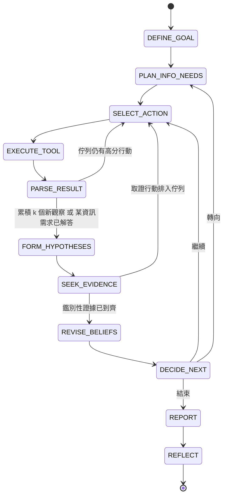

# 04 — 研究迴圈與可觀察性（需求 A）

> 核心原則：迴圈是**程式碼中的狀態機**。LLM 只在指定步驟做「判斷」並以 structured outputs 回傳；「下一步做什麼、能不能做、還剩多少預算」由程式決定。**每一步都要讓使用者看得到。**

---

## 0. 目前版本：以三個問題為終點的研究迴圈（2026-10-17 改版）

> 本文件 §1–6 記錄研究期間的設計（狀態機、Frontier、預算、證據探針、可觀察性），這些都仍然適用。改版後，研究的終點固定為三個問題，迴圈的每一步都為推導這三個結論服務：
>
> 1. 競品採取了哪些關鍵的 **On-page** SEO 策略？
> 2. 競品採取了哪些關鍵的 **Off-page** SEO 策略？
> 3. 我們若要與之競爭，**最值得優先採取的行動**為何？

| 迴圈步驟 | 為三個問題做什麼 | 程式模組 |
|---|---|---|
| 定義目標 | 研究目標固定為三個問題，成功條件由程式固定；`data_gaps()` 在開始前說明缺少的資料會讓哪個問題答不了 | `core/steps.py`、`real/env.py` |
| 決定需要資訊 | 系統依可取得的資料補上：網站盤點、**排名頁輪廓**、頁面變化、SERP（有排名來源時）、**反向連結輪廓**（有 CSV 時）、**自家網站輪廓**（有自家網址時）；拿不到的資料排除並說明原因 | `core/steps.py` |
| 調用工具 | 先抓 SERP 上的競品排名頁、同網站其他主題頁（對比用）、自家主題頁，並以 Wayback 比對排名頁改版前後；`backlinks` 工具讀取使用者上傳的反向連結 CSV（本機檔案） | `core/profiles.py`、`core/actions.py`、`real/backlinks.py` |
| 解析結果 | 每頁量測固定的策略維度（17 個 On-page、3 個 Off-page），寫進研究紀錄；資料足夠時寫出三種輪廓觀察（排名頁 vs 其他主題頁的對比與檢定、自家輪廓、反向連結輪廓） | `core/strategy.py`、`core/profiles.py` |
| 形成假設 | LLM 只能從固定詞彙中挑選做法，提出 On-page／Off-page 策略假設，並提出競爭的解釋（例如「這個做法所有主題頁都有，不是排名頁特有的」）；程式驗證維度與資料 | `core/beliefs.py`、`llm/roles.py` |
| 尋找客觀證據 | 四種免費探針由程式判定：排名頁對比（Fisher 精確檢定）、排名頁普及率、採用時序（改版前後）、反向連結訊號 | `core/probes.py` |
| 修正推論 | log-odds 信心更新、紅隊驗證；紅隊不以「無法證明因果」單獨反對策略假設，改看量測本身是否薄弱 | `core/beliefs.py`、`core/steps.py` |
| 報告 | 策略結論附程式量測的數字；優先行動依「影響（信心 × 普及率）× 自家差距 ÷ 實作難度」由程式排序，自家已做到的列為「維持」；沒有結論時由程式說明原因與資料缺口 | `core/claims.py`、`core/priority.py` |
| 學習 | REFLECT 照常萃取經驗；沒有結論時也記錄原因，寫進記憶 | `memory/reflect.py` |

**為什麼要這樣改**：實際使用時發現，沒有排名資料的研究每次都無結論、也學不到東西。舊版的研究問題是「哪些內容變化讓它取得排名」，找不到期間內有變化的主題頁，就沒有可以檢驗的證據；而「是否因果」在沒有排名歷史時永遠無法證明，紅隊每次都以此反對（[08 §5.3](08-eval-day1-vs-dayN.md)）。改版後，策略的定義是「有排名的頁面普遍採用、且通常在期間內採用的做法」，報告會明確寫出因果無法證明。

---

## 1. 為什麼不是黑盒子

| 黑盒子做法（禁止） | 本設計 |
|---|---|
| 把網址丟給 LLM，直接吐報告 | 8 個步驟各有獨立 handler，輸入輸出都是型別化的 Pydantic model |
| 看不到決策過程 | 執行時即時輸出每一步；事後有完整 trace 與時間軸 |
| LLM 自由呼叫工具 | 工具只能由 `SELECT_ACTION` 產生的 `Action` 觸發，且先過 `PolicyGate` 與 `BudgetLedger` |
| 數字由 LLM 生成 | 數字（排名變化、字數差異、樣本數）一律由程式計算，LLM 只負責詮釋 |
| 報告直接採信 | 每個主張必須引用 observation ID，由程式驗證 |

---

## 2. 迴圈主體

### 2.1 程式結構（`src/seo_intel/core/loop.py`）

```python
class ResearchLoop:
    def run(self, state: EpisodeState) -> EpisodeState:
        while True:
            step = self.controller.next_step(state)          # 確定性：依狀態決定下一步
            if step is Step.DONE:
                break
            verdict = self.policy.check_step(step, state)    # 自治邊界（見 06）
            if verdict.requires_approval:
                return self.pause_for_approval(state, verdict)
            if self.budget.exhausted(step):
                state = state.force_finalize(reason="budget")
                continue
            result = self.handlers[step].run(state)          # 各步驟實作
            state = state.apply(result)                      # 不可變更新
            self.observer.emit(step, result, self.budget.snapshot())   # 即時輸出 + 寫 trace
            self.store.checkpoint(state)                     # 可中斷、可續跑
        return state
```

### 2.2 狀態轉移



### 2.3 步驟定義

| # | 需求步驟 | 本設計 | 執行者 | 輸出 | 學習介入點 |
|---|---|---|---|---|---|
| 1 | 定義目標 | `DEFINE_GOAL` | Opus | `ResearchGoal`：問題、範圍、成功條件 | 檢索相似任務經驗（M1） |
| 2 | 決定需要資訊 | `PLAN_INFO_NEEDS` | Opus | `InfoNeed[]`：每項需求的「解答條件」與候選工具 | M1 |
| 3 | 調用 Tool | `SELECT_ACTION` → `EXECUTE_TOOL` | **程式**評分 | `Action` → `ToolResult` / `ToolError` | URL 範本價值（M2）、避開已知失敗路徑（M1） |
| 4 | 解析結果 | `PARSE_RESULT` | **程式**萃取；Haiku 僅摘要證據候選頁 | `Observation[]`（帶 ID） | — |
| 5 | 形成假設 | `FORM_HYPOTHESES` | Opus | `Hypothesis[]`：可證偽、必須引用觀察 | M1 |
| 6 | 尋找客觀證據 | `SEEK_EVIDENCE` | Opus 提出鑑別問題 → **程式**轉成具體行動 | 高優先取證行動 | M1 |
| 7 | 修正推論 | `REVISE_BELIEFS` | **程式** log-odds 更新；Opus 紅隊驗證 | 新信心度、矛盾清單 | — |
| 8 | 決定下一步 | `DECIDE_NEXT` | **程式**規則 | 繼續 / 轉向 / 結束 | — |
| — | 收尾 | `REPORT` → `REFLECT` | Opus ＋ 程式引用驗證 | 報告；寫入 M1 / M2 | 寫入 |

### 2.4 範例：資訊需求拆解

目標：「為什麼自家站在『長照保險』群組排名下滑？」

資訊需求的種類（`kind`）由 LLM 從固定清單中選擇，程式再把每種需求對應到固定的行動：

| kind | 問題 | 行動 | 程式判定「已解答」的條件 |
|---|---|---|---|
| `rank_change` | 目標網域在主題查詢上的排名何時、變化多少？ | `rank_scan`（主題） | 所有目標網域都已掃描 |
| `control_check` | 自家站其他主題是否同時變化？（排除全站性因素） | `rank_scan`（對照組） | 已掃描 |
| `serp_competitors` | 誰在主題查詢上取代了自家站？ | `serp_scan` | 已比較事件前後的 SERP |
| `site_inventory` | 競品有哪些範本、哪些近期更新？ | `discover` | 所有目標網域都已探勘 |
| `page_changes` | 競品主題頁面改了什麼？ | `fetch` → `history_diff` | 同一範本累積 3 頁顯著變動或新增（優先 SERP 上升者的網域） |

---

## 3. 工具

所有對外請求都經過唯一出口 `HttpToolkit`（`tools/http.py`），依序套用：快取 → robots 檢查 → 斷路器 → 預算 → 速率限制（policy 與 crawl-delay 取較大者）→ 請求 → 重試（僅 429 / 5xx / 逾時，遵守 `Retry-After`）。每次 HTTP 嘗試都記錄在 trace。

迴圈中的行動（`Action.tool`）與其使用的工具：

| 行動 | 內容 | 成本 |
|---|---|---|
| `rank_scan` | 主題或對照組查詢的排名時間序列 → `stats` 計算變化量與起始日 | API 呼叫（每查詢 1 次） |
| `serp_scan` | 變化最大的查詢在事件前後的 SERP → 找出上升者與其排名網址 | API 呼叫 |
| `discover` | robots → sitemap index → 子 sitemap，一次取得數萬 URL 與 `lastmod` | 約 10 次抓取 |
| `fetch` | 抓取單頁 → `extract` 確定性萃取（title、H1/H2、字數、schema、FAQ、表格、日期、連結、注入掃描） | 1 次抓取 |
| `history_diff` | 歷史快照（SimWeb 中模擬 Wayback）→ 與目前版本 `diff`，變動類型詞彙與評測標準答案一致 | 2 次 API 呼叫 |

---

## 4. 成本控制：在數萬頁中決定先抓哪些 URL

### 4.1 三道漏斗

```
網站約 20,000 個 URL（sitemap，成本：數次請求）
  │ ① 範本分群 + 陷阱過濾（本地，0 成本）
  ▼
約 30 個範本（/guide/{slug}、/tag/{x}、/product/{id}、?page=N …）
  │ ② 範本評分 → 分層抽樣（每範本先抽 2–3 頁）
  ▼
約 60 頁探勘樣本 → 程式萃取特徵（0 token）
  │ ③ 假設驅動的定向抓取
  ▼
約 40 頁證據頁 → 約 30 頁交給 Haiku 摘要
```

### 4.2 範本分群與陷阱

- 路徑正規化：數字段 → `{id}`、slug → `{slug}`、日期段 → `{date}`；移除追蹤參數。
- 陷阱：分面參數組合、無限日曆、分頁深度 > 5、近似重複頁（simhash）→ 降權或排除。
- 每範本抓取上限 15 頁。

### 4.3 URL 評分（`core/frontier.py`）

```
score(u) =  w_rel   · Relevance(u, goal)      # slug / 錨點文字與目標關鍵字的 BM25，不用 LLM
          + w_val   · V̂(template(u))          # 範本的證據產出率（M2 學習而來）
          + w_fresh · Freshness(lastmod)
          + w_auth  · Authority(u)             # 站內被連結數、深度
          + w_exp   · UCB_bonus(template(u))   # 未抽樣範本的探索加分
          − w_avoid · Avoid(u)                 # M1 失敗經驗：已知封鎖 / 陷阱路徑
          − TrapPenalty(u)
```

第 1 次分析時 `V̂` 用通用先驗、`Avoid` 為空；第 2 次起由學習機制提供——這是「進步」最直接可量化之處。每個 `Action` 都記錄各項分數，可回答「為什麼先抓這頁」。

### 4.4 假設驅動抓取

`SEEK_EVIDENCE` 問：「哪個觀察能最有效地區分 H1 與 H2？」例：
- H1「競品改版 /guide/ 造成位移」vs. H2「全站性因素造成下滑」
- 鑑別行動：① 抓 /guide/ 中 `lastmod` 落在下滑前的頁面與其前一版本；② 查自家站**非重疊查詢**（對照組）
- 對照組也下滑 → 支持 H2；只有重疊查詢下滑 → 支持 H1

### 4.5 預算

| 硬上限 | 預設 |
|---|---|
| `max_fetches` | 300 次 / episode（每網域 150 次） |
| `max_api_calls` | 200 次（排名、歷史快照 API） |
| `max_llm_usd` | US$2.00 / episode（依 `response.usage` × 價格表即時累計） |
| `max_wall_time_s` | 1,200 秒（環境時鐘；SimWeb 為虛擬時鐘，LLM 延遲也計入） |
| `max_actions` | 300 個工具行動；迴圈另有 10 倍的步驟數安全上限 |

| 階段預留（累進制） | 比例 | 累計抓取上限 |
|---|---|---|
| Discovery | 10% | 30 |
| Sampling | 40% | 150 |
| Targeted | 35% | 255 |
| Verification | 15% | 300（前面階段不可動用） |

前面階段沒用完的額度順延到後面，但驗證額度永遠保留。

### 4.6 LLM 角色與成本

| 角色 | 模型 | effort |
|---|---|---|
| Planner、Hypothesizer、Verifier | `claude-opus-5-5`（$4 / $20 每百萬 token） | medium / high |
| Extractor | `claude-haiku-5-5`（$0.10 / $0.50） | low |

- 全部以 `messages.parse()` + Pydantic schema 取得結構化輸出。
- Prompt caching：固定的 system prompt 放最前，變動內容放最後；以 `usage.cache_read_input_tokens` 驗證。
- 檢查 `stop_reason`（`refusal`、`max_tokens`）；Opus 5.5 啟用 server-side fallback。
- 估算：每個 episode 約 US$1.2（Extractor 約 $0.03、Opus 約 20 次呼叫約 $1.15）。
- **Phase 2 實測**：s1 一個完整 episode 的 LLM 花費 **US$0.044**（只有 DEFINE_GOAL 與 PLAN_INFO_NEEDS 兩次 Opus 呼叫，第二次起 system prompt 命中快取）。Phase 3 加入假設與驗證後會再實測。
- **Extractor 在 Phase 2 不啟用**：SimWeb 的頁面內容是合成文字，確定性萃取的特徵（字數、schema、FAQ、章節、日期）已足以判斷；加上 LLM 摘要只增加成本，不增加資訊。

---

## 5. 假設、證據與修正推論（Phase 3 實作）

### 5.1 形成假設（`FORM_HYPOTHESES`）

LLM（hypothesizer）讀取程式整理的觀察摘要（排名統計、SERP 排名網址的範本分布、各範本更新比例、已確認的變動），提出 2–4 個**競爭**假設。程式檢查可證偽性後才接受：

| 檢查 | 不合格時 |
|---|---|
| 主張、預測、反證條件不可空白 | 拒收，保留理由 |
| 必須引用存在的觀察 ID | 移除不存在的引用；一個都沒有則拒收 |
| 競品假設的範本必須是實際觀察到的範本 | 拒收 |
| 先驗夾在 0.1–0.6 | 自動夾值（信心必須靠證據升上去） |

### 5.2 尋找客觀證據（`SEEK_EVIDENCE`）：證據探針

證據的**方向與強度由程式規則判定**，LLM 只決定要不要花錢取得某種證據。

| 探針 | 成本 | 判定規則 |
|---|---|---|
| `control_vs_topic` 對照組比較 | 免費 | 對照組變化 ÷ 主題變化 ≤ 0.4 → 主題層級原因（對各競品假設只算**弱**支持，因為無法區分是哪個範本）；≥ 0.7 → 全站性因素 |
| `serp_template_share` SERP 排名網址範本 | 免費 | 競品排名網址屬於該範本的比例；競品不是 SERP 上升者則反對 |
| `template_burst` 範本更新爆發度 | 免費 | 範本期間內更新比例 ÷ 全站平常比例：≥ 2 倍為集中改版；< 1.3 倍為背景變動 |
| `timing_alignment` 時序吻合 | 免費 | **最早**觀察到的變動須早於排名變化起始日；連最早的變動都晚於起始日 7 天以上 → 強反對 |
| `competitor_rank_gain` 競品排名變化 | API | 競品同期是否進步 |
| `template_change_sample` 範本變動抽樣 | 抓取 | **隨機**抽樣（不用 frontier 排序），以**二項檢定**比較變動率與全站背景率；樣本不足就明說「不足以區分」 |

免費探針一律執行；花錢的探針由 LLM（evidence planner）依鑑別力挑選，使用保留給驗證的預算。

### 5.3 修正推論（`REVISE_BELIEFS`）

```
logit(p) = logit(prior) + Σ direction × weight(strength)
weight：strong = 1.5、moderate = 0.8、weak = 0.3
```

| 規則 | 說明 |
|---|---|
| 成立 | p ≥ 0.8 **且**通過紅隊驗證 |
| 推翻 | p ≤ 0.2 |
| 矛盾 | 同時有強支持與強反對 → 維持測試中，不下結論 |
| 紅隊驗證 | p ≥ 0.7 時觸發；驗證者**看不到提出者的推理**，但拿得到計算所需的資料節錄 |
| 紅隊計分 | 反駁必須引用有效觀察；單次審查最多計入 2 項（一中一弱），其餘只記錄——紅隊的價值在找漏洞，不在以數量壓倒證據 |

### 5.4 報告（`REPORT`）

- **結構化主張**由程式從「成立」的假設推導：網站、範本、變動類型（取自歷史比對）、時間窗、信心、證據 ID。
- LLM（reporter）只撰寫說明；文中引用 `[C1] [H2] [EV-3] [O-5]` 逐一驗證，不存在的移除並計數。
- 產出 `runs/<id>/report.md` 與 `summary.json`（含主張，供評測使用）。

### 5.5 結束條件（依序檢查）

1. 硬上限（LLM 花費、時間、行動數）用盡 → 先修正推論再結束。
2. 證據佇列有行動 → 繼續；有探針執行完尚未判定 → 修正推論。
3. 尚未形成假設 → 蒐集資料；資訊需求都關閉後形成假設。
4. 仍有測試中的假設 → 最多再找兩輪證據。
5. 所有假設都被推翻或拒收 → 重新提出假設（最多兩輪）。
6. 否則結束：`hypothesis_supported`、`inconclusive` 或 `no_valid_hypotheses`。
7. 等待核准 → 暫停（非結束）。

---

## 6. 可觀察性（本研究的核心要求）

讓使用者在**執行中**與**執行後**都能看清楚 Agent 在想什麼、做什麼、為什麼。

### 6.1 四種觀察方式

| 方式 | 何時用 | 看到什麼 |
|---|---|---|
| **即時主控台** | 執行中 | 每一步即時印出：步驟名稱、決策、理由、預算進度條、目前假設與信心度 |
| **逐步模式** `--step` | 執行中，想仔細看 | 每一步結束後暫停，按 Enter 才繼續；可隨時中止並續跑 |
| **`trace show`** | 執行後，在終端機 | 完整時間軸文字版 |
| **`timeline.html`** | 執行後，在瀏覽器 | 單一靜態 HTML：步驟時間軸、URL 評分表、假設信心度曲線、預算曲線、套用了哪些經驗、每次 LLM 呼叫的輸入摘要與結構化輸出 |

### 6.2 即時主控台範例

```
[17] SELECT_ACTION  fetch https://competitor-b.sim/guide/ltc-insurance-cost
     理由：鑑別 H1 vs H2——lastmod=09-12 落在下滑窗口前
     評分：0.82 = 相關 0.31 + 範本價值 0.24 + 新鮮度 0.18 + 權威 0.09 − 成本 0.02
     套用經驗：L-0042（此站 /guide/ 範本過去證據產出率 0.61）
     預算：抓取 ███████░░░░░ 88/300 · LLM $0.41/$2.00 · 階段 targeted
[18] EXECUTE_TOOL   fetch → 200 OK（412 ms）
[19] PARSE_RESULT   觀察 O-131：字數 1,240 → 2,010（+62%）、新增 FAQPage schema
[20] REVISE_BELIEFS H1 0.58 → 0.71（+moderate）   H2 0.30 → 0.24
```

### 6.3 Trace 格式（`runs/<episode_id>/trace.jsonl`）

```json
{"seq": 17, "step": "SELECT_ACTION",
 "action": {"tool": "fetch", "url": "https://competitor-b.sim/guide/ltc-insurance-cost"},
 "reason": "鑑別 H1 vs H2：lastmod=09-12 落在下滑窗口前",
 "score": {"total": 0.82, "relevance": 0.31, "template_value": 0.24, "freshness": 0.18, "authority": 0.09, "explore": 0.0, "avoid": 0.0, "cost": -0.02},
 "lessons_applied": ["L-0042"],
 "budget": {"fetches": 88, "llm_usd": 0.41, "phase": "targeted"}}
```

LLM 呼叫另記錄於 `llm_calls`：角色、模型、token、成本、**結構化輸出全文**——使用者可以檢視 LLM 每次「判斷了什麼」。

### 6.4 指令

```bash
seo-intel research --scenario s1
```

```bash
seo-intel research --scenario s1 --step
```

```bash
seo-intel research --scenario s1 --llm fake
```

```bash
seo-intel research resume <episode_id>
```

```bash
seo-intel trace list
```

```bash
seo-intel trace show <episode_id>
```

```bash
seo-intel trace html <episode_id>
```

- `--step`：每一步後等待輸入（Enter 繼續、`c` 連續執行到結束、`q` 暫停並存檔）。暫停只會發生在「安全點」：工具結果尚未解析前不會暫停。
- `--llm fake`：確定性假規劃器，免費、可重現；`--llm live`（預設）自動把 LLM 呼叫錄製到 `runs/<id>/llm_cassette.jsonl`，可用 `--llm replay --cassette <檔案>` 重播。
- 每個 episode 的產物都在 `runs/<id>/`：`trace.jsonl`、`checkpoint.json`、`timeline.html`、`summary.json`、`environment.json`（SimWeb 伺服器判定的違規，非 Agent 自報）。
