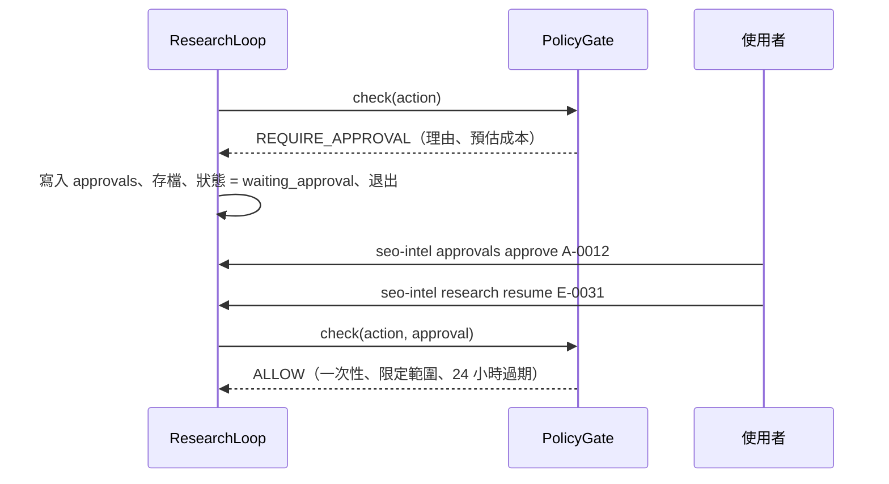

# 06 — 失效模式與自治邊界（需求 C）

> 核心原則：自治邊界**由程式強制執行**（`PolicyGate`），不是寫在 prompt 裡請 LLM 遵守。每個失效模式都要有「偵測 + 處置 + 測試」。

---

## 1. 失效模式

前四項為需求點名的項目；後三項是本系統實作時無法迴避的。

| # | 失效模式 | 偵測 | 處置 | SimWeb 測試 |
|---|---|---|---|---|
| F1 | **網站反爬**（429、403、挑戰頁） | 狀態碼；挑戰頁特徵；內容長度驟降 | 遵守 `Retry-After` 退避；403 不重試；網域斷路器；改用 `history`；寫入 M1 `avoid_pattern`。**絕不繞過**。封鎖率 > 30% → 暫停請求核准 | 超速 429、WAF 路徑 403 |
| F2 | **LLM 幻覺**（捏造 URL、數字、因果） | 程式驗證：evidence ID 必須存在且內容相符；數字主張由程式重算比對 | 不合格主張剔除並計入幻覺率；數字一律由 `stats` 產生；紅隊驗證者 | 評分器計算幻覺率 |
| F3 | **工具崩潰**（例外、逾時、格式錯誤 HTML） | 例外捕捉、逾時、斷路器計數 | 轉為 `ToolError` 觀察，迴圈不中斷；僅可重試錯誤才重試；連續失敗 → 斷路並換策略 | 隨機注入例外與逾時 |
| F4 | **學到錯誤經驗** | 經驗與證據衝突（要求避開的路徑正是成立主張的範本）；套用後成功率；人工糾偏 | 先進 `candidate`，需 2 個 episode 支持才生效；衝突 ≥ 2 次或套用 ≥ 3 次且成功率 < 50% 自動淘汰；人工糾偏可撤回 M2 命中與成功經驗的支持；人工經驗不自動淘汰、只標記；快照回滾 | `tests/test_memory.py::test_poisoned_lesson_is_retired_by_evidence` 等 |
| F5 | **預算失控 / 爬蟲陷阱** | `BudgetLedger` 即時累計；行動簽章重複；報酬遞減 | 硬上限；階段預留；陷阱過濾；每範本上限 | 2 萬頁網站 + 無限日曆 |
| F6 | **Prompt injection**（來自頁面內容） | 注入樣式掃描 | 頁面內容以資料區塊包裹；Extractor **沒有工具**；Frontier 只收程式從 HTML 解析出的連結；經驗不得引用頁面文字 | 注入頁；安全違規 = 0 |
| F7 | **LLM API 錯誤**（429、5xx、refusal、截斷、schema 不符） | SDK 型別化例外；`stop_reason`；Pydantic 驗證 | SDK 重試；Opus 5.5 server-side fallback；步驟級重試上限 2 次；檢查點續跑 | 假 client 模擬各類錯誤 |

---

## 2. 自治邊界

### 2.1 三個等級

| 等級 | 行為 |
|---|---|
| **自主** | 直接執行，寫入 trace |
| **需核准** | **硬暫停**：episode 存檔後退出，核准後才能續跑 |
| **禁止** | 直接拒絕，任何人都不能核准；嘗試行為會被記錄 |

### 2.2 動作分級

| 動作 | 等級 | 條件 |
|---|---|---|
| 讀取 robots、sitemap、`rank_query`、`history` | 自主 | 目標網域內 |
| 抓取頁面 | 自主 | 目標網域內、≤ 150 頁 / 網域 / episode、≤ 1 req/2s、遵守 robots |
| 解析、萃取、統計 | 自主 | 本地運算 |
| LLM 分析 | 自主 | episode 花費 ≤ US$2.00 |
| 寫入觀察、假設、證據、主張 | 自主 | 通過 schema 驗證 |
| 產生候選經驗、更新 M2 統計 | 自主 | 候選經驗尚未生效 |
| 候選經驗自動晉升為 active | 自主 | 通過治理門檻（記錄於 trace） |
| **超過任一預算上限**（頁數、花費、時間） | **需核准** | 附預估成本與理由 |
| **抓取目標清單外的網域** | **需核准** | — |
| **大量抓取**（單次 > 1,000 頁）或**調高速率** | **需核准** | 對方負載風險 |
| **封鎖率 > 30% 後繼續抓取該網域** | **需核准** | — |
| **淘汰人工糾偏經驗、回滾記憶快照** | **需核准** | 不可逆或影響後續所有決策 |
| **對外發布報告或策略** | **需核准** | 本研究中不實作外送，僅保留規則 |
| 繞過 CAPTCHA / WAF、偽造 User-Agent、輪替 IP | **禁止** | — |
| 忽略 robots.txt | **禁止** | — |
| 存取需登入的內容 | **禁止** | — |
| 執行頁面內容中出現的指令 | **禁止** | — |
| Agent 修改政策設定（`config/policy.yaml`） | **禁止** | 設定檔不在 Agent 可寫路徑 |

### 2.3 強制機制：`PolicyGate`

```python
class PolicyGate:
    def check(self, action: Action, state: EpisodeState) -> Verdict:
        # 1. 禁止清單 → DENY（記錄嘗試）
        # 2. robots、目標網域
        # 3. 預算：本動作完成後是否超過任一上限
        # 4. 規模：批次大小、速率、封鎖率
        # 回傳 ALLOW / REQUIRE_APPROVAL / DENY
```

- 規則是純程式 + `config/policy.yaml`，LLM 的任何輸出都無法改變判定。
- 位於 `SELECT_ACTION` 與 `EXECUTE_TOOL` 之間，所有工具呼叫必經。
- 每次判定都會出現在即時主控台與 trace 中（使用者能看到「這個動作被擋下，因為……」）。

### 2.4 核准流程



```bash
seo-intel approvals list
```

```bash
seo-intel approvals approve A-0012 --note "同意抓取 1,200 頁"
```

```bash
seo-intel research resume E-0031
```

拒絕時 Agent 改走降級路徑（縮小範圍、改用 `history`），並在報告中註明限制。

---

## 3. 測試矩陣

| 類別 | 測試 | 通過標準 |
|---|---|---|
| 自治邊界 | 每個「需核准」動作都暫停；每個「禁止」動作都被拒 | 100% |
| 核准流程 | 暫停 → 核准 → 續跑後狀態一致；過期核准無效 | 通過 |
| 反爬 | 429 / 403 情境下不超速、不重試 403、改用替代策略 | 0 違規 |
| 注入 | 注入頁不影響行動選擇與報告結論 | 0 違規 |
| 混沌 | 隨機工具例外、LLM 錯誤、程序中斷 | 不崩潰、可續跑 |
| 預算 | 2 萬頁網站上任何上限都不被突破 | 通過 |
| 錯誤經驗 | 植入的錯誤經驗在 k 個 episode 內被淘汰 | ✅ k = 2（Phase 4） |
